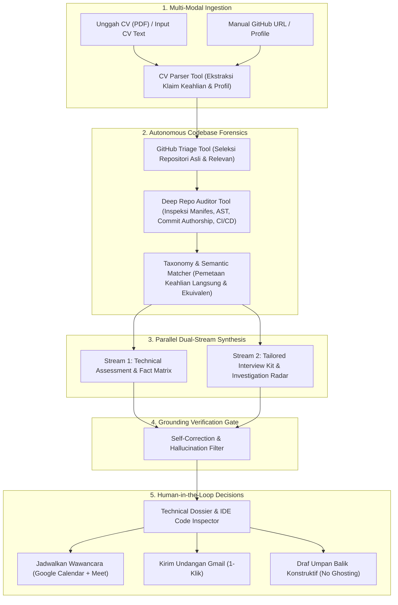

# 🚀 TalentTrace AI — Autonomous Technical Screener & Portfolio Auditor

> **"Resume tells stories, code shows reality."**  
> *Sistem Agen AI Otonom untuk Validasi Teknis Kandidat Rekayasa Perangkat Lunak Berbasis Portofolio Kode Riil.*

[](https://github.com/Reizo-Rajendra/Lomba-AI-HRD)
[](https://github.com/Reizo-Rajendra/Lomba-AI-HRD)
[](https://nodejs.org)
[](https://www.typescriptlang.org)
[](https://react.dev)
[](https://vitejs.dev)
[](https://tailwindcss.com)

---

## 📌 Latar Belakang & Masalah Industri (2023 - 2026)

1. **Inflasi Resume & Keyword Stuffing**: Lebih dari 70% pelamar mempercantik klaim di CV dengan bantuan Generative AI, membuat sistem Applicant Tracking System (ATS) konvensional kebanjiran CV yang tampak "100% cocok" di atas kertas.
2. **Matinya Tes Koding Otomatis (The Death of LeetCode / Take-Home Test)**: Hadirnya AI koding (Cursor, Copilot, ChatGPT) membuat tes koding mandiri seminggu kehilangan validitasnya karena dapat dikerjakan AI dalam hitungan detik.
3. **Beban Waktu Tech Lead**: Tim HR (non-teknis) kesulitan membedakan arsitektur produksi nyata dengan proyek hasil copy-paste tutorial, memaksa *Engineering Manager* dan *Tech Lead* menghabiskan **15–20 jam kerja produktif per minggu** hanya untuk memeriksa portofolio GitHub secara manual.

---

## 💡 Solusi: TalentTrace AI

**TalentTrace AI** menghadirkan agen kecerdasan buatan otonom (*Agentic AI*) yang menjembatani HR dan Engineering Lead:
- **Autonomous Codebase Forensics**: Membedah repositori publik GitHub kandidat secara otomatis (manifes dependensi, struktur direktori level 3, status kepemilikan git commit, hingga automated test suites).
- **Claim-vs-Evidence Matrix**: Memetakan setiap klaim keahlian di CV secara transparan terhadap bukti paket dependensi riil (Verified, Transferable, atau No Public Evidence).
- **Filosofi Technical Ownership (Bukan AI Witch-Hunt)**: Agen tidak menghukum kandidat karena menggunakan AI koding, melainkan menguji kepemilikan teknis: *apakah kandidat benar-benar memahami kode dan trade-off arsitektur yang dibuatnya*.
- **Tailored Interview Kit**: Merumuskan pertanyaan wawancara teknis kontekstual berdasarkan kode riil kandidat, lengkap dengan panduan *Green Flags* (sinyal kandidat paham) dan *Red Flags* (sinyal copy-paste buta).
- **1-Click Workspace Action**: Integrasi langsung dengan Google Calendar & Gmail untuk mengirim undangan wawancara atau memberikan draf umpan balik konstruktif (*No-Ghosting Recruitment*).

---

## 🏗️ Alur Agen Otonom (Pipeline Architecture)



---

## ✨ Fitur Unggulan

| Fitur | Deskripsi |
| :--- | :--- |
| 🛡️ **Technical Ownership Verifier** | Memeriksa apakah commit Git cocok dengan profil kandidat atau hasil fork/kloning tanpa kontribusi riil. |
| 📊 **Evidence Matrix & Fact Anchors** | Memverifikasi klaim keahlian dengan tautan berkas dan dependensi riil di repositori kandidat. |
| 🎯 **Investigation Radar** | Mengidentifikasi anomali, klaim tanpa bukti publik, atau area abu-abu yang perlu ditanyakan saat wawancara. |
| 💻 **Embedded Web IDE Launcher** | Mini code viewer terintegrasi di panel dengan tombol 1-klik untuk membuka repo di editor web berbasis VS Code (`github.dev`). |
| 💬 **AI Deliberation Partner** | Ruang konsultasi interaktif di mana Tech Lead dapat berdialog dengan AI yang mengingat seluruh rekam jejak audit kode kandidat. |
| 📅 **Google Workspace Actions** | Integrasi OAuth 2.0 untuk penjadwalan Google Calendar (link Google Meet otomatis) dan pengiriman draf email via Gmail API. |
| 💌 **Constructive Feedback Engine** | Menghasilkan umpan balik teknis yang membangun untuk kandidat yang belum lolos, menjaga reputasi *employer branding*. |

---

## 🛠️ Tech Stack

- **Frontend**: React 19, TypeScript, Vite, Tailwind CSS v4, Atlassian Design System (@atlaskit), Lucide Icons.
- **Backend**: Node.js v24, Express, TypeScript (`tsx watch`), Octokit REST (GitHub API), PDF-Parse, Google APIs (OAuth 2.0, Calendar, Gmail).
- **AI & LLM Gateway**: OpenAI SDK / OpenRouter API (`google/gemini-2.0-flash-001`, `claude-3-5-sonnet`, `gemini-3.8-flash`), dilengkapi modul *deterministic fallback* & sandbox mock.

---

## 🚀 Panduan Instalasi & Menjalankan

### Prasyarat
- **Node.js** >= v20 (Disarankan v22 atau v24)
- **npm** >= v10

### 1. Clone Repositori
```bash
git clone https://github.com/Reizo-Rajendra/Lomba-AI-HRD.git
cd Lomba-AI-HRD
```

### 2. Konfigurasi Environment (`.env`)
Salin file `.env.example` ke `.env`:
```bash
# Windows PowerShell
copy .env.example .env

# Linux / macOS
cp .env.example .env
```

Sesuaikan isian variabel lingkungan:
```env
PORT=5000
NODE_ENV=development

# LLM Gateway (OpenRouter / OpenAI-compatible endpoint)
ROUTER_API_KEY=your_api_key_here
ROUTER_BASE_URL=https://openrouter.ai/api/v1
ROUTER_MODEL=google/gemini-2.0-flash-001

# Opsional: GitHub Token untuk memperbesar batas rate limit API
GITHUB_TOKEN=

# Opsional: Google OAuth 2.0 untuk integrasi Calendar & Gmail
GOOGLE_CLIENT_ID=your_client_id.apps.googleusercontent.com
GOOGLE_CLIENT_SECRET=your_client_secret
GOOGLE_REDIRECT_URI=http://localhost:5000/api/auth/google/callback
```
*(Catatan: Jika `ROUTER_API_KEY` dikosongkan, sistem tetap berjalan normal menggunakan mesin audit deterministik bawaan).*

### 3. Install Dependensi
```bash
# Install dependensi backend
cd server
npm install
cd ..

# Install dependensi frontend
cd client
npm install
cd ..
```

### 4. Menjalankan Aplikasi

#### **Cara A: Mode Development (Live Reload)**
Buka 2 tab terminal:
- **Terminal 1 (Backend Server)**:
  ```bash
  cd server
  npm run dev
  ```
  *(Berjalan di `http://localhost:5000`)*

- **Terminal 2 (Frontend Client)**:
  ```bash
  cd client
  npm run dev
  ```
  *(Buka browser di **`http://localhost:5173`**)*

#### **Cara B: Mode Production (Satu Perintah)**
```bash
npm run build:client
npm run build:server
npm start --prefix server
```
Buka browser di **`http://localhost:5000`**.

---

## 🧪 Preset Dataset untuk Uji Coba Demo

Tersedia dataset simulasi siap pakai di folder `docs/DEMO_CANDIDATE_PRESETS.md`:

1. **Kandidat 1 (High Fit / Terverifikasi)**:
   - **Target Job**: `Frontend Web Engineer (Enterprise UI)`
   - **GitHub**: `https://github.com/HelloRayy`
   - **Hasil**: Klaim React, TypeScript, Tailwind CSS terverifikasi langsung pada dependensi repositori publik.
2. **Kandidat 2 (Resume Puffery / Klaim Tanpa Bukti)**:
   - **Target Job**: `Senior Distributed Systems Architect`
   - **GitHub**: `https://github.com/octocat`
   - **Hasil**: Deteksi klaim arsitektur mikroservis & Kafka yang tidak didukung oleh bukti kode di repositori publik.

---

## 👥 Tim & Pengembang

Dikembangkan untuk:
**Garda Tech National Innovation Competition (GTNIC) 2026**  
*Kategori: AI Agents — Enterprise Productivity*

- **Author**: [Reizo Rajendra](https://github.com/Reizo-Rajendra)

---

## 📄 Lisensi
Distributed under the **ISC License**. Lihat berkas `package.json` untuk informasi lisensi lebih lanjut.
